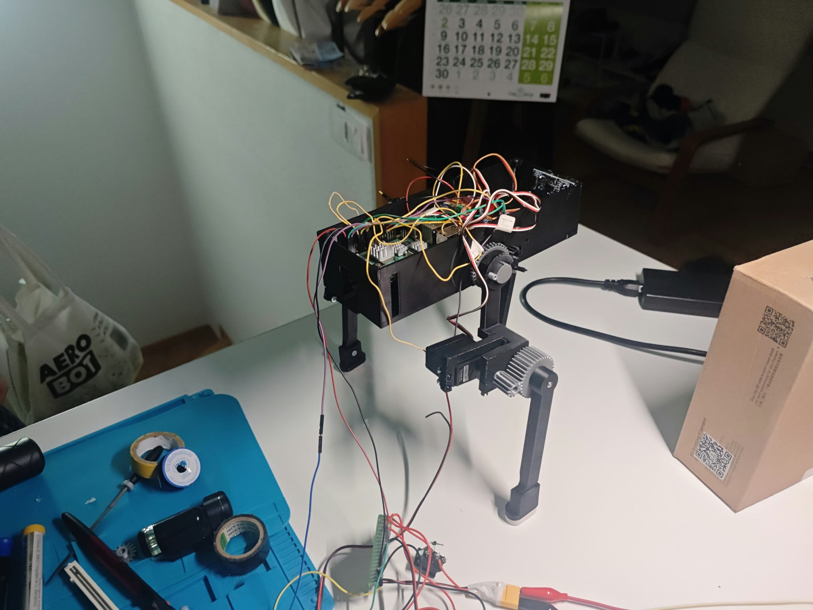

# Robot Sube-Escaleras

Proyecto de la asignatura **Mecatrónica** del **Grado en Ingeniería de Robótica Software** de la **Universidad Rey Juan Carlos (URJC)**.

## Componentes del grupo:

- Adrián Manzanares Romera: [Amanza17](https://github.com/Amanza17)
- Claudia Élez Mencía: [celezm](https://github.com/celezm)
- Mario Casero Sández: [MarioC05](https://github.com/MarioC05)
- Rebeca Castilla Puerta [rumbahuh](https://github.com/rumbahuh)


## Objetivo

Diseñar, fabricar y programar un robot terrestre capaz de **subir al menos un peldaño** de las escaleras del laboratorio III de la URJC, manteniendo la estabilidad y evitando obstáculos durante la aproximación.

### Requisitos principales

- Subir al menos un peldaño en **menos de 1 minuto**.
- Detectar y evitar obstáculos durante la aproximación, partiendo de **20 cm de la contrahuella**, dentro del tiempo establecido.
- No superar **25 × 25 × 25 cm** para el robot completo.
- Utilizar **baterías recargables**, sin alimentación por cable durante las pruebas.
- Diseñar y fabricar una **estructura propia**.
- Incorporar una interfaz para **iniciar y detener** el funcionamiento.
- Respetar la restricción de **locomoción sin ruedas** establecida en el enunciado.

## Diseño seleccionado

Durante la fase de diseño conceptual se estudiaron cuatro alternativas:

1. Robot cuadrúpedo tipo perro.
2. Robot bípedo con cuerpo horizontal y rueda loca delantera retráctil.
3. Robot serpiente modular.
4. Robot lineal tipo impresora 3D, con pie fijo y pie móvil.

La propuesta elegida para continuar el desarrollo es el **bípedo**. Consta de dos patas articuladas y un apoyo delantero mediante rueda loca que puede replegarse hacia atrás.

## Estructura del repositorio


```text
Mecatronica/
├── README.md
├── planificacion/
│   ├── diagrama_gantt
│   └── diagrama_pert
│   └── planificacion_nov
├── diseno_conceptual/
│   │   ├── matriz_calidad
│   │   └── matriz_seleccion
│   │   └── diseño_conceptual
├── diseno_detallado
│   ├── Eltronico.FCStd
│   ├── motores.pdf
│   └── piezas
│       ├── designed
│       │   ├── battery.FCStd
│       │   ├── ...
│       └── internet
│           ├── adafruit.FCStd
│           ├── ...
└── simulacion
    └── pybullet
        ├── eltronico.urdf
        ├── pybullet_meshes
        │   ├── Adafruit.stl
        │   ├── ...
        └── simulacion_estatica_escalon.py
└── eltronico_ws
    └── src  
        ├── eltronico
        ├── ir
        └── tui     
```

## Estado del proyecto

Actualmente, se está finalizando el montaje definitivo de las piezas del robot. El montaje de la electrónica está prácticamente finalizado, a expensas de la llegada de una PCB que integra los 2 reguladores de voltaje y algunas resistencias y la integración de un sensor infrarrojo para comandar al robot con un mando ir.

Respecto a la programación, se sigue trabajando en el controlador para la subida del escalón y en la migración e integración del código de MQTT y scripts de python a ROS2.


*Este es el robot a día 19 de noviembre*

En la carpeta [media](./media) se pueden encontrar distintas fotos y videos del montaje del robot y de pruebas de los motores.
